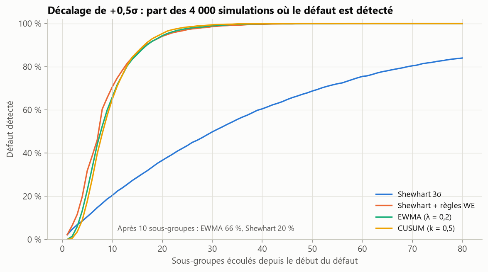
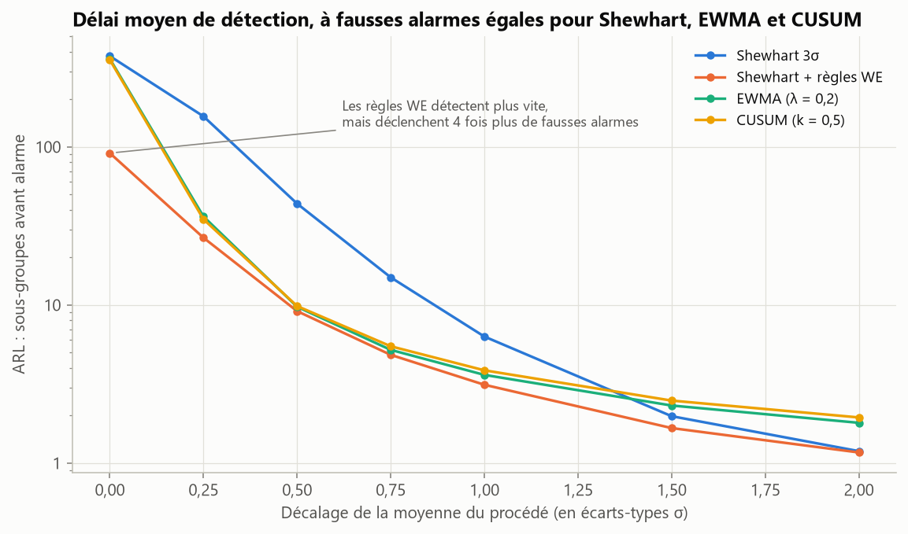
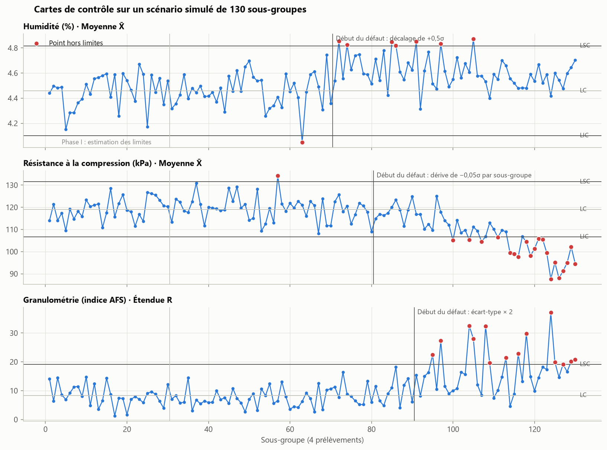

# Contrôle statistique des procédés : sable de fonderie

[](https://github.com/narusly/spc-fonderie/actions/workflows/tests.yml)

Détecter au plus tôt la dérive d'un procédé sans crier au loup : cartes de Shewhart, règles de Western
Electric, EWMA et CUSUM, comparées **à taux de fausses alarmes égal** sur le cas du sable de fonderie
(humidité, granulométrie, résistance à la compression). Projet inspiré de mon stage d'analyste de
laboratoire en fonderie automobile.

## En bref

- **Pour un petit décalage, la carte de Shewhart est lente.** Face à un décalage de 0,5σ de la moyenne,
  elle met en médiane 31 sous-groupes à réagir, contre 8 pour l'EWMA et 9 pour le CUSUM. Après 10
  sous-groupes, elle n'a détecté le défaut que dans 20 % des cas, contre 66 % pour l'EWMA.
- **Pour un grand décalage, c'est l'inverse.** À partir de 1,5σ, Shewhart réagit plus vite que l'EWMA et le
  CUSUM, qui lissent l'information.
- **Les règles de Western Electric ont un prix.** Elles accélèrent la détection, mais divisent par 4 le délai
  avant une fausse alarme (92 sous-groupes au lieu de 370). Une comparaison honnête doit fixer ce coût
  d'abord : EWMA et CUSUM sont donc **calibrés par simulation** sur le même ARL₀ que Shewhart.



## Problème

En fonderie, l'humidité, la granulométrie et la résistance du sable conditionnent la qualité des pièces. Une
dérive vue trop tard, c'est une série de pièces rebutées ; une fausse alarme, c'est une production arrêtée
pour rien. Quelle carte de contrôle choisir, et avec quels réglages ?

## Méthode

1. **Données simulées.** Les données réelles de fonderie ne sont pas publiables. Je simule donc des
   sous-groupes de 4 prélèvements autour de cibles réalistes (humidité 4,5 %, indice AFS 55, résistance
   120 kPa), avec trois types de défauts : décalage brusque, dérive lente, hausse de la dispersion.
2. **Phase I.** Limites estimées sur 30 sous-groupes sous contrôle : moyenne générale, σ estimé par R̄/d₂,
   constantes A₂, D₃, D₄ des cartes X̄–R.
3. **Méthodes comparées.** Shewhart 3σ ; Shewhart + les quatre règles de Western Electric ; EWMA (λ = 0,2) ;
   CUSUM tabulaire bilatéral (k = 0,5).
4. **Calibrage à fausses alarmes égales.** La limite L de l'EWMA et le seuil h du CUSUM sont ajustés par
   dichotomie, avec des nombres aléatoires communs, pour que l'ARL₀ vaille 370,4, comme pour Shewhart. On
   trouve L = 2,859 et h = 4,755, conformes aux tables de la littérature.
5. **ARL par Monte Carlo.** 4 000 séries par point, avec erreur standard. La simulation de Shewhart est
   validée contre sa formule exacte.

## Résultats



| Décalage (σ) | Shewhart (exact) | Shewhart + WE | EWMA | CUSUM |
|---:|---:|---:|---:|---:|
| 0 (fausses alarmes) | 370,4 | 91,4 | 360,7 | 355,3 |
| 0,25 | 155,2 | 26,6 | 36,3 | 34,9 |
| 0,5 | 43,9 | 9,1 | 9,7 | 9,8 |
| 1 | 6,3 | 3,1 | 3,6 | 3,9 |
| 2 | 1,2 | 1,2 | 1,8 | 1,9 |

ARL en nombre de sous-groupes. Intervalles de confiance et détail dans
[`reports/resultats.md`](reports/resultats.md).

### Sur un scénario de production



Chaque défaut appelle sa carte : X̄ pour un décalage ou une dérive de la moyenne, R (étendue) pour une
hausse de la dispersion. Une seule trajectoire reste une anecdote. Sur ce tirage, Shewhart repère le
décalage de 0,5σ dès le 2ᵉ sous-groupe grâce à un point extrême ; en moyenne il lui en faut 44. C'est
pourquoi les conclusions s'appuient sur les 4 000 simulations, pas sur ce graphique.

**Capabilité (phase I)**, avec des tolérances hypothétiques : Cpk = 1,20 pour l'humidité et 1,17 pour la
résistance (procédés capables, sans marge confortable), mais 0,97 pour la granulométrie (< 1 : le procédé
produit des pièces hors tolérance même sans défaut).

## Limites et pistes

- Mesures supposées indépendantes et gaussiennes. Un procédé réel est souvent autocorrélé : il faudrait
  alors surveiller les résidus d'un modèle ARIMA.
- Une carte par caractéristique. Les trois grandeurs sont liées physiquement : une carte multivariée
  (T² de Hotelling, MEWMA) tiendrait compte de leurs corrélations.
- λ = 0,2 et k = 0,5 sont optimaux pour des décalages d'environ 1σ ; à ajuster au défaut que l'on craint.

## Reproduire

```bash
python -m venv .venv
source .venv/bin/activate            # Windows : .venv\Scripts\activate
pip install -e ".[dev]"
pytest                               # 16 tests, dont la validation contre la littérature
python -m spcfonderie.report         # régénère reports/ (environ 1 minute)
```

## Structure

```
src/spcfonderie/process.py   simulation du sable : cibles, tolérances, défauts
src/spcfonderie/charts.py    cartes X̄–R, règles de Western Electric, EWMA, CUSUM, capabilité
src/spcfonderie/arl.py       ARL par simulation, formule exacte de Shewhart, calibrage
src/spcfonderie/report.py    analyse complète, tableaux et figures
tests/                       motifs des règles, propriétés des cartes, ARL de référence
```

---
Maxime Fruntes · Master 2 Mathématiques appliquées (Probabilités et Statistiques), Université de Lorraine ·
[LinkedIn](https://www.linkedin.com/in/maxime-fruntes-2538543a5/) · Licence MIT
